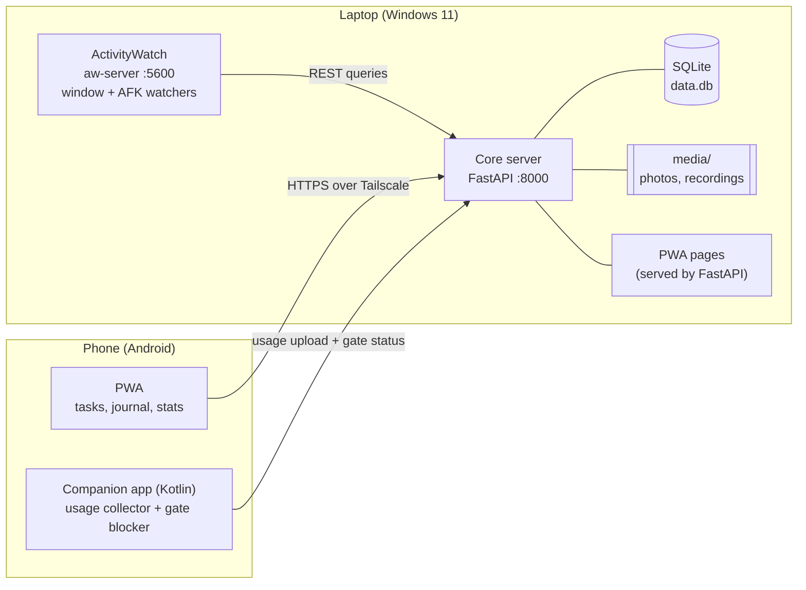
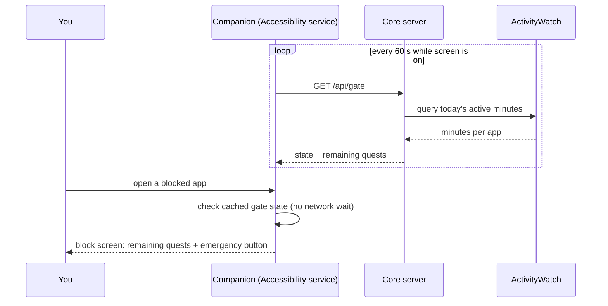

# Self-Help App — Blueprint

> **Working title:** TBD · **Version:** 0.1 · **Owner/user:** Nao (single user)
> **Platforms:** Windows 11 laptop (server + tracking) · Android phone (companion + PWA)


## 0. Decisions so far (Oct 2026)

These override anything below that says otherwise.

| Topic | Decision |
|---|---|
| Name | **questlog** (working name) |
| Repo | One **public** monorepo on GitHub, MIT license. Personal data, config, and tokens are gitignored. |
| Laptop UI | The PWA, plus a small **Python tray app** later (Phase 3+). No Electron or Tauri. |
| Web pages | Server-rendered **Jinja2 templates with plain HTML forms**. htmx only if a page needs it. No npm, no build step. |
| Python | 3.12 managed by **uv**, `ruff` for linting and formatting, `pytest` for the gate, quest, and day-rollover logic. |
| Android | **Kotlin + Jetpack Compose**, sideloaded. Not on the Play Store: the closed-testing rule, the AccessibilityService review, and the laptop-server setup make it not worth it. Others can sideload the APK from GitHub Releases. |
| ActivityWatch | Queried through its REST API with `httpx` (no `aw-client` dependency). |
| Device auth | One token per device. The server tells laptop from phone by token, not by IP, because `tailscale serve` makes every request look local. |
| Day rollover | Quests for a day are created the first time that day is opened, so nothing breaks if the laptop sleeps through 4:00 am. |
| Setup | `setup.bat` installs only named packages (Git, uv, ActivityWatch, Tailscale) and never upgrades other software. |

---

## 1. Purpose

### The problem
- The **laptop is where work happens**. The **phone is where the dumb stuff happens**, and reaching for it is the default escape.
- Willpower alone doesn't hold. The app adds **friction** so the easy path is the work path.

### What the app does
1. **Tracks** app usage on the laptop (Windows 11) and the phone (Android).
2. Holds a **daily list of quests** (tasks) and checks them off: automatically when laptop data proves it, manually otherwise.
3. **Locks distracting phone apps** until the day's required quests are done.
4. Keeps a **simple journal**: Markdown text plus photos of the physical journal, readable from anywhere.
5. Turns everything logged (studying, coding, guitar, singing, drawing, music production) into **XP and levels**.

### Design principles
| Principle | What it means in practice |
|---|---|
| **Friction beats willpower** | Unlocking is decided on the laptop, not the phone. You can't tick "done" from bed. |
| **Data, not guilt** | Emergency unlocks are allowed, but every one is logged and shows up in weekly stats. |
| **One user, local-first** | Everything runs on the laptop. No accounts, no cloud service. |
| **Mostly CRUD** | Only three parts are clever: ActivityWatch queries, the gate, and the Android blocker. |
| **Fewer task switches** | Work happens in sessions with a *beginning action* and an *ending action*. |

### Non-goals
Multi-user support, app store release, iOS, and real-time sync between many devices.

---

## 2. How a day works

| When | What happens in the app |
|---|---|
| **10–11 pm (night before)** | Evening review in the journal: gratitude notes, today's reflection, pick today's study subject for tomorrow and 1–2 tasks for the morning. These become tomorrow's quests. |
| **Morning** | Phone is locked (blocklisted apps only). Laptop shows the **Today** screen. |
| **Work blocks** | *Start session* → beginning action → work → *End session* → ending action. ActivityWatch confirms the active minutes. |
| **Silingan / campus** | Laptop keeps tracking. Phone stays usable for calls, messages, maps, banking. |
| **Required quests done** | The gate opens: phone apps unlocked for the rest of the day, XP awarded. |
| **Sunday** | Open day. Gate stays open, streaks don't break. |
| **Friday night** | Weekly review screen + plan the weekend. |

**Starter daily quests** (Mon–Sat template): 1 study subject (one subject per day), guitar, singing, 1 coding project.

---

## 3. System architecture



### Components
| Component | Runs on | Job |
|---|---|---|
| **ActivityWatch** | Laptop | Records the active window and AFK status. Used as-is, not modified. |
| **Core server** | Laptop | All the logic: quests, gate, XP, journal, stats. The single source of truth. |
| **SQLite + `media/` folder** | Laptop | Storage for data and attachments. |
| **PWA** | Laptop browser + phone | The only UI for tasks, journal, sessions, stats. Written once, used on both. |
| **Android companion** | Phone | Two jobs: upload phone usage, block apps while the gate is locked. |
| **Tailscale** | Both | Private network so the phone reaches the laptop from anywhere. |

### Why this split
- ActivityWatch is great on Windows, but its Android app only serves its API while the app is open, and its sync is still a work in progress. So the phone gets its own small companion app.
- One web UI instead of two native UIs. The native Android code is limited to what a web page can't do: reading usage stats and blocking apps.

---

## 4. Modules

### 4.1 Quests (tasks)
- **Templates** per weekday (Mon–Sat) generate each day's quests at rollover. You can also add **one-off quests**.
- Each quest has a **verification type**:
  - `auto`: passes when ActivityWatch shows enough active (non-AFK) time matching a rule, e.g. `acad.exe` ≥ 60 min.
  - `manual`: tick it off. From the laptop, a tick is enough. From the phone, it needs proof (photo or recording).
  - `photo`: always needs an attachment, e.g. a photo of a finished sketch.
- `required: true` means it counts toward the gate.

Example auto rule (`rule_json`):
```json
{
  "type": "aw_minutes",
  "match": { "app": ["acad.exe"], "title_regex": null },
  "min_minutes": 60
}
```

### 4.2 Sessions (timestamped log)
- **Start session:** pick a skill and write the beginning action, e.g. *"open plate 4, headphones on."*
- **End session:** write the ending action, e.g. *"saved, next step is dimensions on plate 4."*
- This gives timestamped logs and XP for things ActivityWatch can't see: guitar, singing, drawing on paper.
- Rules: sessions can't overlap, and a session longer than 2 h needs a note.

### 4.3 Gate (phone lock)
States: `LOCKED`, `OPEN`, `EMERGENCY` (temporary).

```text
if today is Sunday                  -> OPEN
if an emergency unlock is active    -> EMERGENCY until expires_at
if all required quests are done     -> OPEN until next rollover
else                                -> LOCKED
```

- **Emergency unlock:** 15 minutes, requires typing a reason, max 3 per week, shown in weekly stats.
- **Always allowed:** phone, SMS/messaging, maps, banking/e-wallet, camera, clock, the companion app, the installed PWA.
- **Day rollover at 4:00 am**, so late nights still count as the same day.



### 4.4 Journal
- **Entries:** date, title, Markdown body, tags.
- **Attachments:** photos (physical journal pages, sketches) and audio (guitar or singing takes).
- **Evening review template:**
  ```markdown
  ## Gratitude
  -
  -
  -
  ## Today
  ## Tomorrow
  - Study subject:
  - Morning task 1:
  - Morning task 2:
  ```
  Saving the review turns the "Tomorrow" lines into tomorrow's quests.
- **Search:** full-text over entries with SQLite FTS5. Later, OCR text from photos joins the same index.

### 4.5 Skills, XP, levels
See section 9.

### 4.6 Stats
- **Today:** active minutes per category (laptop), phone screen time per app, quest status, gate history.
- **Week:** totals per skill, streaks, emergency unlocks, laptop-work vs phone-time ratio.

---

## 5. Data model (SQLite)

ActivityWatch data is **not copied**. The server queries it live. Phone usage is stored as daily totals per app.

```sql
CREATE TABLE devices (
  id          INTEGER PRIMARY KEY,
  name        TEXT NOT NULL,
  kind        TEXT NOT NULL CHECK (kind IN ('laptop','phone')),
  token_hash  TEXT UNIQUE NOT NULL
);

CREATE TABLE skills (
  id        INTEGER PRIMARY KEY,
  name      TEXT UNIQUE NOT NULL,   -- Study, Coding, Guitar, Singing, Drawing, Drums, Music Production
  icon      TEXT,
  total_xp  INTEGER NOT NULL DEFAULT 0
);

CREATE TABLE journal_entries (
  id          INTEGER PRIMARY KEY,
  day         TEXT NOT NULL,        -- 'YYYY-MM-DD'
  title       TEXT,
  body_md     TEXT NOT NULL DEFAULT '',
  tags        TEXT,
  created_at  TEXT NOT NULL,
  updated_at  TEXT NOT NULL
);

CREATE TABLE attachments (
  id          INTEGER PRIMARY KEY,
  entry_id    INTEGER REFERENCES journal_entries(id),
  path        TEXT NOT NULL,        -- media/2026/10/<sha256>.jpg
  mime        TEXT NOT NULL,
  sha256      TEXT UNIQUE NOT NULL,
  ocr_text    TEXT,                 -- filled in later (Phase 6)
  created_at  TEXT NOT NULL
);

CREATE TABLE quest_templates (
  id         INTEGER PRIMARY KEY,
  title      TEXT NOT NULL,
  skill_id   INTEGER REFERENCES skills(id),
  verify     TEXT NOT NULL CHECK (verify IN ('auto','manual','photo')),
  rule_json  TEXT,                  -- only for verify = 'auto'
  required   INTEGER NOT NULL DEFAULT 1,
  weekdays   TEXT NOT NULL DEFAULT '1,2,3,4,5,6',  -- ISO weekdays, Mon = 1
  archived   INTEGER NOT NULL DEFAULT 0
);

CREATE TABLE quests (                -- one row per quest per day
  id             INTEGER PRIMARY KEY,
  template_id    INTEGER REFERENCES quest_templates(id),  -- NULL for one-offs
  day            TEXT NOT NULL,      -- after the 4 am rollover
  title          TEXT NOT NULL,
  skill_id       INTEGER REFERENCES skills(id),
  verify         TEXT NOT NULL,
  rule_json      TEXT,
  required       INTEGER NOT NULL,
  status         TEXT NOT NULL DEFAULT 'pending'
                 CHECK (status IN ('pending','done','skipped')),
  completed_at   TEXT,
  completed_via  TEXT,               -- 'auto' | 'laptop' | 'phone+proof'
  proof_id       INTEGER REFERENCES attachments(id)
);

CREATE TABLE sessions (
  id             INTEGER PRIMARY KEY,
  skill_id       INTEGER NOT NULL REFERENCES skills(id),
  started_at     TEXT NOT NULL,
  ended_at       TEXT,
  begin_action   TEXT,
  end_action     TEXT,
  note           TEXT,
  attachment_id  INTEGER REFERENCES attachments(id)
);

CREATE TABLE xp_events (
  id          INTEGER PRIMARY KEY,
  skill_id    INTEGER NOT NULL REFERENCES skills(id),
  amount      INTEGER NOT NULL,
  reason      TEXT NOT NULL,         -- 'minutes', 'quest_bonus', 'day_bonus', 'streak_bonus', 'review'
  ref         TEXT,                  -- e.g. 'session:42', 'quest:17'
  created_at  TEXT NOT NULL
);

CREATE TABLE phone_usage (
  day      TEXT NOT NULL,
  package  TEXT NOT NULL,
  label    TEXT,
  seconds  INTEGER NOT NULL,
  PRIMARY KEY (day, package)
);

CREATE TABLE app_rules (
  id        INTEGER PRIMARY KEY,
  platform  TEXT NOT NULL CHECK (platform IN ('windows','android')),
  pattern   TEXT NOT NULL,           -- exe name, package name, or window-title regex
  kind      TEXT NOT NULL CHECK (kind IN ('category','block','allow')),
  skill_id  INTEGER REFERENCES skills(id)
);

CREATE TABLE gate_events (
  id          INTEGER PRIMARY KEY,
  type        TEXT NOT NULL,         -- 'opened', 'emergency', 'blocker_offline'
  reason      TEXT,
  device_id   INTEGER REFERENCES devices(id),
  created_at  TEXT NOT NULL,
  expires_at  TEXT
);

CREATE TABLE settings (
  key    TEXT PRIMARY KEY,
  value  TEXT NOT NULL
);

-- Full-text search over the journal (add the usual insert/update/delete sync triggers)
CREATE VIRTUAL TABLE journal_fts USING fts5(
  title, body_md, content='journal_entries', content_rowid='id'
);
```

---

## 6. API (FastAPI)

| Method | Path | Purpose |
|---|---|---|
| GET | `/api/today` | Today's quests, gate state, active minutes per category |
| POST / PATCH | `/api/quest-templates`, `/api/quest-templates/{id}` | Manage weekday templates |
| POST | `/api/quests` | Add a one-off quest |
| POST | `/api/quests/{id}/complete` | Manual completion (multipart, optional proof file) |
| POST | `/api/sessions/start` | `{skill_id, begin_action}` |
| POST | `/api/sessions/{id}/end` | `{end_action, note}` |
| GET / POST | `/api/journal` | List / create entries (`?q=` searches FTS) |
| GET / PATCH | `/api/journal/{id}` | Read / edit an entry |
| POST | `/api/attachments` | Upload a photo or audio file |
| GET | `/api/gate` | `{state, remaining_quests, expires_at}` |
| POST | `/api/gate/emergency` | `{reason}` → 15-minute unlock |
| POST | `/api/phone/usage` | Daily totals from the companion (doubles as a heartbeat) |
| GET | `/api/stats/day?d=`, `/api/stats/week?d=` | Stats pages |
| GET | `/api/skills` | XP, levels, streaks |

**Auth:** each device has its own token. The companion sends `Authorization: Bearer <token>`. The PWA asks for the token once and keeps a session cookie.

**The "no ticking from bed" rule:** `POST /api/quests/{id}/complete` from a device with `kind = 'phone'` and no proof file returns `403`. The server identifies the device by its token, not by IP address, because Tailscale's HTTPS proxy makes every request look like it comes from localhost.

---

## 7. Laptop side

### 7.1 ActivityWatch
- Install it and let it start with Windows (it sits in the tray).
- Watchers: `aw-watcher-window` and `aw-watcher-afk` come built in. Optional: `aw-watcher-web` for browser tabs, useful for anything web-based like BandLab.
- Its API lives at `http://localhost:5600`. **Keep it on localhost.** It has no authentication.

### 7.2 Querying it from Python
```python
from datetime import datetime, time, timedelta
from aw_client import ActivityWatchClient

client = ActivityWatchClient("selfhelp-server")

QUERY = """
afk = flood(query_bucket(find_bucket("aw-watcher-afk_")));
win = flood(query_bucket(find_bucket("aw-watcher-window_")));
win = filter_period_intersect(win, filter_keyvals(afk, "status", ["not-afk"]));
win = merge_events_by_keys(win, ["app"]);
RETURN = sort_by_duration(win);
"""

def active_minutes_by_app(day):
    start = datetime.combine(day, time(4, 0)).astimezone()   # 4 am rollover
    end = start + timedelta(days=1)
    result = client.query(QUERY, [(start, end)])[0]
    return {e["data"]["app"]: e["duration"] / 60 for e in result}
```
Notes:
- App names are what the window watcher reports, usually the executable name (e.g. `acad.exe` for AutoCAD). Check your real data in the ActivityWatch web UI before writing rules.
- `app_rules` with `kind = 'category'` map apps or window titles to skills, so the same query feeds both quest checks and XP.
- Check the query against the ActivityWatch docs for your installed version. The query language occasionally gains or renames functions.

### 7.3 Core server
- **FastAPI + Uvicorn** bound to `127.0.0.1:8000`.
- **Exposed to the phone with `tailscale serve`**, which gives HTTPS at `https://<laptop-name>.<tailnet>.ts.net`. HTTPS matters because a PWA can only be installed from a secure origin.
- **Autostart:** a Task Scheduler task "At log on" that runs a small `start_server.pyw` script (starts Uvicorn, logs to a file, no console window).
- **Background jobs (APScheduler):**
  - 4:00 am rollover: generate today's quests from templates, settle yesterday's streaks.
  - Nightly backup (see 7.4).
- **Laptop asleep?** The server sleeps too. The phone falls back to its cached gate state (section 8.3).

### 7.4 Backups
Everything lives on one laptop, so a dead SSD means a lost journal. Every night:
- Back up the database with SQLite's online backup (`conn.backup(...)` in Python), never by copying `data.db` while it's open.
- Copy `media/` to an external drive or a cloud-synced folder.

---

## 8. Android companion (Kotlin, sideloaded)

### 8.1 Jobs
| Job | How |
|---|---|
| **Usage collector** | WorkManager periodic job (15 min is the minimum interval) → `UsageStatsManager.queryAndAggregateUsageStats(startOfDay, now)` → `POST /api/phone/usage` |
| **Gate poller** | Refresh `/api/gate` every 60 s while the screen is on, and on unlock. Cache `{state, remaining, fetched_at, expires_at}`. |
| **Blocker** | An `AccessibilityService` listening for `TYPE_WINDOW_STATE_CHANGED`. Blocked package + cached `LOCKED` → go home and show the block screen. |

### 8.2 Blocker sketch
```kotlin
class GateService : AccessibilityService() {
    override fun onAccessibilityEvent(event: AccessibilityEvent) {
        if (event.eventType != AccessibilityEvent.TYPE_WINDOW_STATE_CHANGED) return
        val pkg = event.packageName?.toString() ?: return
        if (pkg in Rules.blocklist && GateCache.isLocked()) {
            performGlobalAction(GLOBAL_ACTION_HOME)
            startActivity(
                Intent(this, BlockActivity::class.java)
                    .addFlags(Intent.FLAG_ACTIVITY_NEW_TASK)
            )
        }
    }
    override fun onInterrupt() {}
}
```
- `BlockActivity` shows the remaining quests and an **Emergency unlock** button (reason required).
- **Blocklist, not allowlist.** Block the known distractions (social media, games, YouTube, the browser) instead of allowing a short list. Fewer surprises.
- **Browser vs PWA:** blocking Chrome would also block the PWA unless it's installed. An installed PWA runs as its own package (a WebAPK, named like `org.chromium.webapk.…`). Check its package name after installing and put it on the allow list.

### 8.3 Offline rules
- Cached gate state is trusted for **6 hours**.
- After 6 hours with no server contact: **fail closed** (`LOCKED`). Emergency unlock still works offline and is uploaded later.
- If the companion stops sending usage uploads while the phone is clearly in use, the server logs a `blocker_offline` event. It shows up in weekly stats, same as an emergency unlock.

### 8.4 Setup gotchas
- **Usage access:** enable it for the companion in Settings → Special app access → Usage access (the exact path varies by phone).
- **Android 13+:** sideloaded apps get "restricted settings." Before enabling the accessibility service, go to App info → ⋮ → *Allow restricted settings*.
- **Battery optimization:** turn it off for the companion, or some phones will kill the service.

---

## 9. Gamification

### Skills (starter set)
Study · Coding · Guitar · Singing · Drawing · Drums · Music Production. Each levels up separately, like RPG skills.

### XP sources
| Source | XP |
|---|---|
| Active laptop minute in a category (AFK excluded) | 1 / min |
| Session minute for an off-laptop skill (guitar, singing, paper drawing) | 1 / min |
| Quest completed | +20 |
| All required quests done for the day | +30 |
| Evening review written | +10 |
| Streak bonus | +10% per consecutive day, capped at +50% |

Sessions tagged to a laptop-tracked skill give the timestamped log but **no extra XP**, since ActivityWatch already counts that time.

### Levels
`level = floor(sqrt(total_xp / 50)) + 1`

| Level | Total XP | Roughly |
|---|---|---|
| 2 | 50 | 1 hour |
| 3 | 200 | 3.5 hours |
| 5 | 800 | 13 hours |
| 10 | 4,050 | 67 hours |

### Streaks
- One streak per skill, plus an overall "all required quests done" streak.
- Sundays neither break nor extend a streak.

### Anti-cheese
- AFK time never counts.
- Overlapping sessions are rejected.
- Sessions over 2 hours need a note.
- Manual completions from the phone need proof.

### Ideas from the YouTube video
*TBD. Add notes here after watching.*

---

## 10. Security & privacy
- Reachable **only on your tailnet**. Never port-forward the server.
- ActivityWatch stays on **localhost** (it has no auth).
- **Per-device tokens**, stored hashed.
- The journal and photos are the most personal data. Keep the nightly backups and turn on Windows device encryption if your laptop supports it.

---

## 11. Tech stack

| Layer | Choice | Why |
|---|---|---|
| Laptop tracking | ActivityWatch | Already does it well |
| Server | Python 3.12 (via uv), FastAPI, Uvicorn | Simple, fast to build, great for CRUD |
| Database | SQLite (+ FTS5) | One file, no setup, built-in full-text search |
| Jobs | APScheduler | Rollover and backups inside the server process |
| Frontend | Jinja2 templates + plain forms, PWA manifest + service worker | Server-rendered CRUD pages, no build step |
| Desktop | Python tray app (`pystray`), later | Gate color, quick sessions, notifications |
| Markdown | markdown-it-py | Renders journal entries |
| Android | Kotlin, WorkManager, AccessibilityService, OkHttp | Only the parts a web page can't do |
| Network | Tailscale + `tailscale serve` | Private access from anywhere, with HTTPS |
| Autostart | Windows Task Scheduler | Server starts at log on |

---

## 12. Project structure

See the repo README for the current layout.

---

## 13. Roadmap

| Phase | Build | Done when |
|---|---|---|
| **0. Setup** | Install ActivityWatch + Tailscale. Script prints today's active minutes per app. | The numbers match the ActivityWatch web UI. |
| **1. Core** | FastAPI + SQLite, quest templates + daily rollover, manual completion, sessions. | You plan tomorrow at night and tick off quests the next day from the laptop. |
| **2. PWA + Journal** | Jinja/htmx pages, Markdown journal, photo upload, evening review template, `tailscale serve`, install on phone. | You upload a journal page photo from the phone and read it on the laptop. |
| **3. Auto-verify + Gate** | ActivityWatch rules, `/api/gate`, emergency unlock, phone-needs-proof rule. | `/api/gate` flips to `OPEN` after 60 real AutoCAD minutes. |
| **4. Android companion** | Usage upload first, then the blocker. | Opening a blocked app before quests are done bounces you to the block screen. |
| **5. Gamification** | Skills, XP, levels, streaks, stats pages. | The weekly page shows XP per skill and emergency unlocks. |
| **6. Later** | OCR on journal photos (Tesseract), weekly reflections from a local LLM (Ollama), earned phone breaks (e.g. 50-min session → 10 min unlocked), ideas from the video. | — |

Phases 1–3 already give you a usable app on the laptop alone.

---

## 14. Open decisions
- [ ] Which phone apps go on the blocklist
- [ ] Which quests are required on each weekday (Saturday has NSTP in the morning)
- [ ] Offline cache length (6 h) and fail-closed vs fail-open
- [ ] Emergency unlock limits (15 min, 3 per week)
- [ ] Day rollover time (4:00 am)
- [ ] Whether phone time should ever cost XP (currently: stats only, no penalty)
- [ ] The app's name
